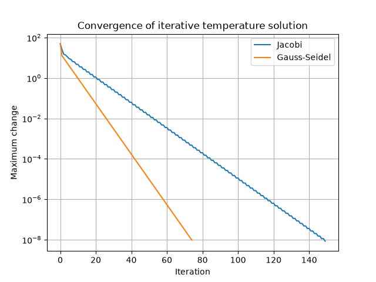
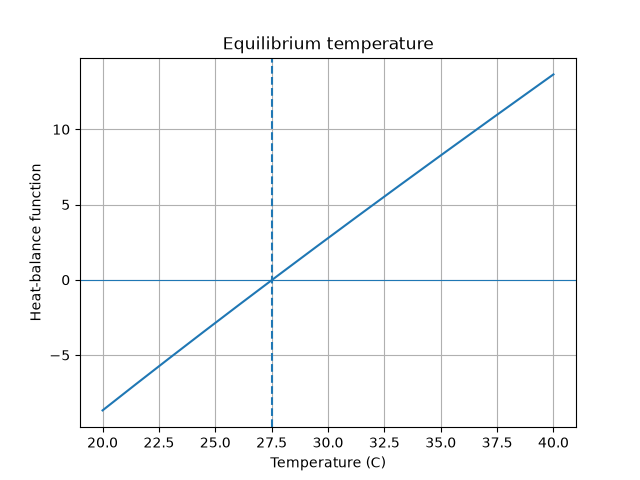
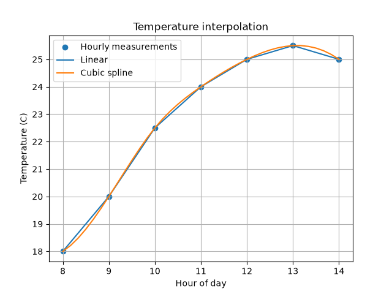
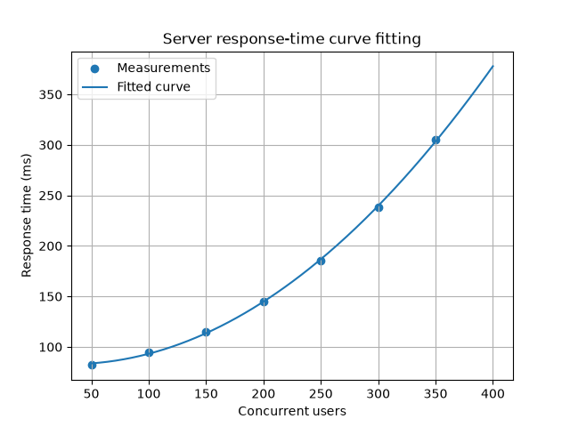
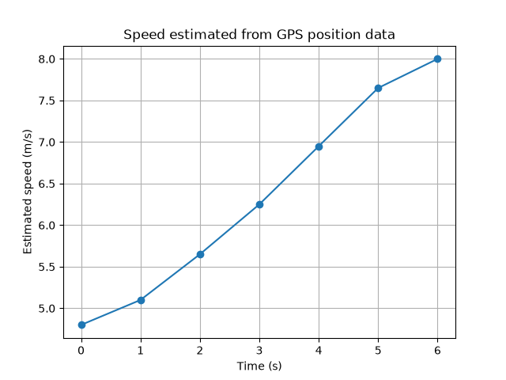

# BIT 2118 Scientific Computing

Name: Fardosa Jibril | Reg No: bsccs202454679

## Task 2: NumPy Arrays and Numerical Computation

**Inputs and operation:** The input is an array of 24 hourly temperatures in °C. The program computes the mean, minimum and maximum, and converts every value to Fahrenheit with F = 1.8C + 32 in one vectorized expression.

**Parameter change:** I changed the peak reading from 29.4 to 35.0. The maximum became 35.0 °C and the mean rose from 23.12 to about 23.35 °C. The mean rose by only (35.0 - 29.4)/24 ≈ 0.23 because one reading is only 1/24 of the total.

**Output interpretation:** The station's average temperature over the day was 23.12 °C, ranging from a cool 17.5 °C in the early morning to 29.4 °C in the early afternoon. The first six Fahrenheit values are about 65.3, 64.4, 64.0, 63.5, 64.2 and 66.2 °F.

**New related case:** Heart-rate readings (bpm) taken every hour for 24 hours. Assumption: readings are accurate and evenly spaced. I computed the mean, min and max with the same NumPy functions, and used a vectorized expression to convert to beats per second (bpm / 60). The mean shows the resting level over the day, and the max shows the most active hour.

## Task 3: Mathematical Functions and Vectorization

**Inputs and operation:** The input is 1,000,000 random latency values between 5 and 250 ms (seed 42). The program converts each to seconds (÷1000) and squares it, once with a Python loop and once with a vectorized NumPy expression.

**Parameter change:** I changed the array size from 1,000,000 to 100,000. The loop time dropped to 0.0233 s and the vectorized time to 0.0007 s, so the speed-up was 35.6x times. Smaller arrays take less time for both methods.

**Output interpretation:** The loop took 0.1575 s and the vectorized version 0.0040 s, a speed-up of about 39.9x. Vectorization is faster because NumPy runs the operation in optimized compiled code instead of executing Python instructions one value at a time. The first five squared latencies (for example 0.0379 s² for the first reading) are small because latencies of a few hundred milliseconds are only fractions of a second.

**New related case:** Convert one million sensor voltages from millivolts to volts and compute power P = V²/R with R = 10 ohms. Assumption: a constant resistance. I timed the loop against the vectorized form again and found vectorization to be much faster, so it is the better choice for large datasets.

## Task 4: Floating-Point Arithmetic and Numerical Errors

**Inputs and operation:** The inputs are 0.1 + 0.2 compared with 0.3, the values √2 and 1.414, and small values of x (1e-4, 1e-8, 1e-12). The program compares numbers exactly and with a tolerance, computes absolute and relative error, and compares two formulas for (√(1+x) - 1)/x.

**Parameter change:** I changed the approximation from 1.414 to 1.4142. The absolute error fell from about 0.00021356 to about 0.00001356, and the relative error fell from 0.0151% to about 0.00096%. More correct digits mean a smaller error.

**Output interpretation:** 0.1 + 0.2 prints 0.30000000000000004, so the exact comparison is False, while np.isclose gives True. Computers store 0.1 and 0.2 approximately in binary. In the last part, the direct formula loses accuracy as x gets very small because it subtracts two nearly equal numbers (catastrophic cancellation), while the rearranged stable formula stays close to 0.5.

**New related case:** Add 0.1 ten times in a loop and compare the total with 1.0. Assumption: ordinary double-precision floats. The total prints 0.9999999999999999, so `total == 1.0` is False and `np.isclose(total, 1.0)` is True. The lesson for banking-style sums is to use a tolerance (or integer cents) rather than exact equality.
## Task 5: Matrix Algebra and Matrix Operations

**Inputs and operation:** The inputs are the four corners of a unit square, a 45° rotation matrix and a scaling matrix (x by 2, y by 1.5). The program multiplies the two matrices to get one transformation and applies it to every point by matrix multiplication.

**Parameter change:** I changed the angle from 45° to 90°. The point (1, 0) moved to (0, 2) instead of (1.41, 1.41), and (1, 1) moved to (-1.5, 2). The determinant stayed 3.0, because rotation does not change area and the scaling gives 2 × 1.5 = 3.

**Output interpretation:** The square becomes a rotated parallelogram. The determinant of 3.0 means every area is multiplied by 3. A positive determinant means the shape is not mirrored.

**New related case:** A triangle with corners (0,0), (4,0), (0,3) is rotated 90° and scaled by 0.5 in both directions. Assumption: the scale is uniform. The new corners are (0,0), (0,2) and (-1.5,0), and the determinant is 0.25, so the area shrinks to a quarter. Tiny values like 1e-16 in the output are round-off error from computing cos(90°).

## Task 6: Solution of Systems of Linear Equations

**Inputs and operation:** The inputs are the CPU and memory use per server type (matrix A) and the observed totals (vector b = [20, 72]). The program solves Ax = b with np.linalg.solve and checks the residual b - Ax.

**Parameter change:** I changed the totals to 24 CPU units and 80 GB. The solution became 4 Type A and 4 Type B servers, instead of 3 and 4. More resource use means more servers.

**Output interpretation:** There are 3 Type A servers and 4 Type B servers. The residual norm is essentially zero (around 1e-15), so the solution reproduces the observed totals.

**New related case:** A bakery makes cakes (x) and pies (y). Cakes need 2 oven-hours and 1 labour-hour, and pies need 1 oven-hour and 3 labour-hours. There are 10 oven-hours and 15 labour-hours available. Assumption: all the hours are fully used. The solution is 3 cakes and 4 pies, and the residual is about zero.

## Task 7: Gaussian Elimination and LU Decomposition

**Inputs and operation:** The inputs are a 3×3 coefficient matrix A and three different measurement vectors. The program factors A once with lu_factor, then solves for each vector with lu_solve.

**Parameter change:** I changed the first measurement vector from [15, 10, 10] to [20, 10, 10]. The solution changed from [5, 5, 5] to about [6.34, 5.37, 5.12]. A larger first measurement raises x the most, because it is directly tied to the first equation.

**Output interpretation:** Each solution gives the unknowns for one measurement set, and the first one is [5, 5, 5]. The residual norms are around 1e-15, so the solutions are accurate and match the direct solve. Factoring once and reusing it saves work when A stays the same.

**New related case:** A smaller coupled system with A = [[3,-1,0],[-1,3,-1],[0,-1,3]] and three new measurement vectors. Assumption: each unknown depends on its neighbours. The first vector [2, 1, 2] gives [1, 1, 1], and the other two also solve with residuals near zero.

## Task 8: Iterative Methods for Linear Systems

**Inputs and operation:** The inputs are a 5×5 tridiagonal matrix, a right-hand side with boundary temperatures of 100 °C and 20 °C, and a tolerance of 1e-8. Jacobi and Gauss-Seidel start from zeros and repeatedly improve the estimate until the change is below the tolerance.

**Parameter change:** I changed the tolerance from 1e-8 to 1e-4. Jacobi iterations fell from about 150 to about 85 and Gauss-Seidel from about 75 to about 42. A looser tolerance lets the methods stop earlier, so fewer iterations are needed, but the temperatures are less accurate (the final change is only below 0.0001 instead of 0.00000001). Gauss-Seidel still needed about half as many iterations as Jacobi.

**Output interpretation:** Both methods give about 86.67, 73.33, 60.00, 46.67 and 33.33 °C, which matches the direct solution. The temperature falls steadily from the hot boundary (100 °C) to the cold boundary (20 °C). Jacobi needed about 150 iterations and Gauss-Seidel about 75, so Gauss-Seidel converged about twice as fast. On the graph, the horizontal axis is the iteration number and the vertical axis is the maximum change in any temperature between iterations, on a log scale. Both lines fall almost straight down from about 50 to below 1e-8, which shows steady convergence. The Gauss-Seidel line is steeper because it uses the newest values immediately within each iteration, while Jacobi waits for the next one.

**New related case:** A heated rod with four interior points, a left boundary of 50 °C and a right boundary of 10 °C. Assumption: steady state with no heat source. The temperatures are about 42, 34, 26 and 18 °C, a straight-line drop.
## Task 9: Eigenvalues and Eigenvectors

**Inputs and operation:** The input is a 4×4 adjacency matrix for a network of nodes A, B, C and D (1 means the nodes are linked). The program finds the eigenvalues and eigenvectors with np.linalg.eig, takes the dominant eigenvector and normalizes it so the scores add up to 1.

**Parameter change:** I added a link between A and D. The dominant eigenvalue rose from 2.56 to 3.0, and every node scored 0.25. Every node now has exactly three links, so no node is more important than another.

**Output interpretation:** The dominant eigenvalue is 2.56. B and C score 0.2808 each and A and D score 0.2192 each. B and C are the most influential nodes because each is linked to all three of the other nodes. The verification error is close to zero, so Av = λv holds.

**New related case:** A relay chain A–B–C in which B links the other two. Assumption: links work in both directions. Input data: A = [[0,1,0],[1,0,1],[0,1,0]]. Output: the dominant eigenvalue is 1.4142 and the scores are 0.2929, 0.4142 and 0.2929. Interpretation: the middle node is the most important, because everything passes through it.

## Task 10: Root Finding: Bisection and Fixed-Point Methods

**Inputs and operation:** The input is the heat-balance function f(T) = T - 25 - 10e^(-T/20), a bracket of [20, 40] and a tolerance of 1e-10. Bisection halves the bracket until it finds f(T) = 0. Fixed-point iteration repeats T = 25 + 10e^(-T/20), starting from T = 30.

**Parameter change:** I changed the constant 10 to 20 in both formulas. The equilibrium temperature rose from 27.53 °C to 29.56 °C, and fixed-point iteration needed 17 steps instead of 13. A larger heat term moves the balance point higher and makes the iteration a little slower.

**Output interpretation:** Both methods give an equilibrium temperature of 27.5252 °C, where heat gain equals heat loss. Fixed-point iteration took 13 iterations. On the graph, the horizontal axis is temperature and the vertical axis is the heat-balance function. The curve rises from about -9 at 20 °C to about +14 at 40 °C and crosses zero once, at the dashed vertical line near 27.5 °C. Below that temperature the function is negative and above it the function is positive.

**New related case:** Break-even quantity for a small business, with profit(q) = 8√q - 0.5q - 20, where q is the number of units. Assumption: profit has diminishing returns. Bisection on [1, 50] (profit is -12.5 at q = 1 and positive at q = 50) gives a break-even of 9.62 units. Interpretation: the business starts making a profit after selling about 10 units.

## Task 11: Root Finding: Newton-Raphson and Secant Methods

**Inputs and operation:** The inputs are an investment of 10,000 followed by yearly inflows of 3000, 3500, 4000 and 2500. The program finds the rate at which the net present value is zero (the internal rate of return, IRR), using Newton-Raphson (with the derivative, starting at 0.10) and the secant method (starting at 0.05 and 0.20).

**Parameter change:** I changed the investment from 10,000 to 9,000. The IRR rose from 11.54% to 16.73%. The same inflows from a smaller investment give a higher return.

**Output interpretation:** Both methods give an IRR of 11.5425%. At that discount rate the present value of the inflows equals the investment, so the NPV is essentially zero. If the cost of borrowing is below 11.54%, the project is worthwhile.

**New related case:** A loan of 5,000 repaid with 1,400 each year for 4 years. Assumption: equal yearly payments. Input data: cash flows [-5000, 1400, 1400, 1400, 1400]. Output: the rate that makes the NPV zero is 4.69% per year. Interpretation: that is the yearly interest rate the borrower is paying on this loan.

## Task 12: Polynomial and Nonlinear Equation Solving

**Inputs and operation:** The inputs are the circle x² + y² = 4 and the parabola y = x² - 1, with starting guesses [1, 1] and [-1, 1]. scipy.optimize.root searches for the (x, y) that makes both equations zero.

**Parameter change:** I changed the circle's right-hand side from 4 to 9 (radius 3 instead of 2). The intersections moved from (±1.52, 1.30) to (±1.84, 2.37). A larger circle meets the parabola higher up.

**Output interpretation:** The two guesses converge to (1.5175, 1.3028) and (-1.5175, 1.3028). The residuals are about 1e-13 and Converged is True for both. The circle and parabola are both symmetric about the y-axis, so the two intersections are mirror images of each other.

**New related case:** A drone flies along the parabola y = x² - 1 and crosses a straight road y = x + 1. Assumption: both are in the same plane. Starting from the guesses [3, 3] and [-2, 0], the solver finds the crossing points (2, 3) and (-1, 0), both with Converged True. Check: 2² - 1 = 3 and (-1)² - 1 = 0.
## Task 13: Interpolation

**Inputs and operation:** The inputs are hourly temperatures from 08:00 to 14:00 (18, 20, 22.5, 24, 25, 25.5 and 25 °C). The program builds a linear interpolation and a cubic spline from them, then estimates the temperature every 10 minutes (37 points from 8 to 14).

**Parameter change:** I removed the 11:00 measurement and estimated the temperature at 11:00 from the other points. Linear interpolation gave 23.75 °C and the cubic spline gave 24.11 °C, while the real value was 24.0 °C. The linear estimate was off by 0.25 °C and the cubic estimate by 0.11 °C, so the smooth spline did better because the temperature curve bends.

**Output interpretation:** At 10:30 the linear estimate is 23.25 °C and the cubic spline estimate is 23.36 °C. On the graph, the horizontal axis is the hour of day and the vertical axis is temperature. The dots are the seven hourly measurements. The linear estimate joins them with straight segments, and the cubic spline passes through the same dots with a smooth curve that rises quickly in the morning and levels off in the afternoon. The two methods differ by at most about 0.19 °C, so either is reasonable here, but the spline gives a more natural curve.

**New related case:** A phone battery voltage measured every hour for 6 hours. Assumption: the voltage falls smoothly as the battery drains. Input data (volts): 4.20, 4.12, 4.02, 3.91, 3.80, 3.70, 3.62. At 2.5 hours the linear estimate is 3.965 V and the cubic estimate is 3.966 V. At 4.5 hours they are 3.750 V and 3.748 V. Interpretation: the two methods agree closely because the voltage falls almost steadily, so the missing readings between measurements can be estimated reliably.

## Task 14: Curve Fitting and Approximation

**Inputs and operation:** The inputs are server response times (82, 95, 115, 145, 185, 238 and 305 ms) measured at 50 to 350 concurrent users. The program fits a quadratic model y = ax² + bx + c with scipy.optimize.curve_fit, which chooses a, b and c to minimize the sum of squared residuals, then reports the RMSE and predicts the response at 400 users.

**Parameter change:** I changed the model from quadratic to linear and to cubic and compared the RMSE. The linear model gave an RMSE of 18.83 ms (a poor fit, because the data bends upward), the quadratic gave 1.55 ms, and the cubic gave 0.14 ms. The predictions at 400 users were 312.86 ms (linear), 377.86 ms (quadratic) and 387.86 ms (cubic).

**Output interpretation:** The fitted model is y = 0.002167x² - 0.1345x + 85.00 with an RMSE of 1.55 ms, so the curve is typically within about 1.5 ms of each measurement. The predicted response at 400 users is 377.86 ms. On the graph, the horizontal axis is the number of concurrent users and the vertical axis is the response time. The dots are the measurements and the fitted curve passes close to every one of them, rising slowly at first and then steeply as the load grows. The prediction at 400 users is extrapolation, outside the measured range of 50 to 350 users, so it is less reliable, and the models disagree by about 10 ms there.

**New related case:** Weekly sales (in thousands) against advertising spend (in thousands) for 7 weeks. Assumption: sales grow about linearly with advertising. Input data: spend 1, 2, 3, 4, 5, 6, 7 and sales 12.5, 15.1, 17.2, 19.8, 22.4, 24.9, 27.3. The linear fit is sales = 2.4714 × spend + 10.00, with an RMSE of 0.11. Interpretation: each extra 1 unit of advertising is linked to about 2.47 extra units of sales, with a baseline of 10 with no advertising. The prediction for a spend of 8 is 29.77.

## Task 15: Numerical Differentiation

**Inputs and operation:** The inputs are GPS positions in metres (0, 4.8, 10.2, 16.1, 22.7, 30.0 and 38.0) at times 0 to 6 s. The program estimates speed using a forward difference at the first point, central differences at the interior points and a backward difference at the last point.

**Parameter change:** I changed the position at t = 3 s from 16.1 m to 17.0 m. The estimated speed at t = 2 s rose from 5.65 to 6.10 m/s and at t = 4 s it fell from 6.95 to 6.50 m/s, while the speed at t = 3 s stayed at 6.25 m/s. A central difference does not use the point itself, only its two neighbours, so a change in one reading shows up in the estimates on either side of it.

**Output interpretation:** The estimated speed rises from 4.8 m/s at t = 0 to 8.0 m/s at t = 6 s (4.8, 5.1, 5.65, 6.25, 6.95, 7.65, 8.0), so the vehicle is speeding up by about 0.5 m/s every second. On the graph, the horizontal axis is time in seconds and the vertical axis is estimated speed. The line rises steadily from left to right, which means constant acceleration. The first and last values use one-sided differences, so they are less accurate than the interior ones.

**New related case:** A falling object, with distance s = 4.9t² metres recorded every 0.5 s for 4 s. Assumption: no air resistance. Input data: 0, 1.225, 4.9, 11.025, 19.6, 30.625, 44.1, 60.025, 78.4 m. The estimated speeds are 2.45, 4.9, 9.8, 14.7, 19.6, 24.5, 29.4, 34.3, 36.75 m/s, and the true speeds (v = 9.8t) are 0, 4.9, 9.8, 14.7, 19.6, 24.5, 29.4, 34.3, 39.2 m/s. The interior estimates match exactly, because central differences are exact for a quadratic, while the two end points are off by 2.45 m/s because they use one-sided differences.

## Task 16: Numerical Integration

**Inputs and operation:** The inputs are smart-meter power readings every two hours over 12 hours (0.8, 1.0, 1.4, 1.8, 1.6, 1.2 and 0.9 kW). The program estimates the total energy (the area under the power curve) with the trapezoidal rule and Simpson's rule.

**Parameter change:** I raised the 06:00 reading from 1.8 kW to 2.6 kW. The trapezoidal energy rose from 15.7 to 17.3 kWh and Simpson's from 15.8 to 17.933 kWh. The two methods now differ by 0.63 kWh instead of 0.1, because a sharper peak is harder for straight segments to approximate.

**Output interpretation:** The trapezoidal rule gives 15.700 kWh and Simpson's rule 15.800 kWh, a difference of 0.100 kWh. So the home used about 15.7 to 15.8 kWh in 12 hours, an average power of about 1.31 kW. The two answers are close because the power changes smoothly.

**New related case:** Distance travelled by a car from its speedometer. Assumption: the speed (m/s) is read every 10 s for 60 s. Input data: 0, 5, 12, 18, 22, 24, 24 m/s. The trapezoidal rule gives 930.0 m and Simpson's rule gives 933.33 m. Interpretation: the car travelled about 930 m in one minute, and the two methods agree within about 3 m.